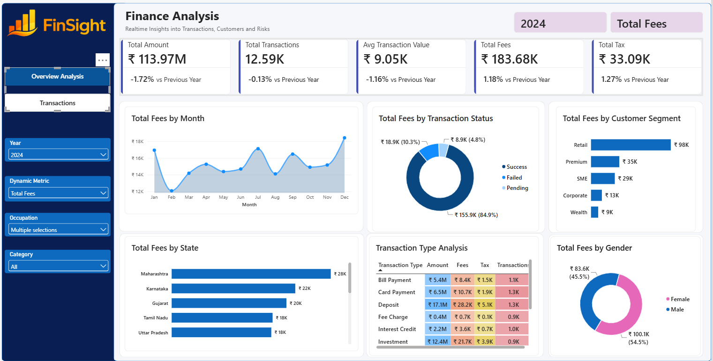
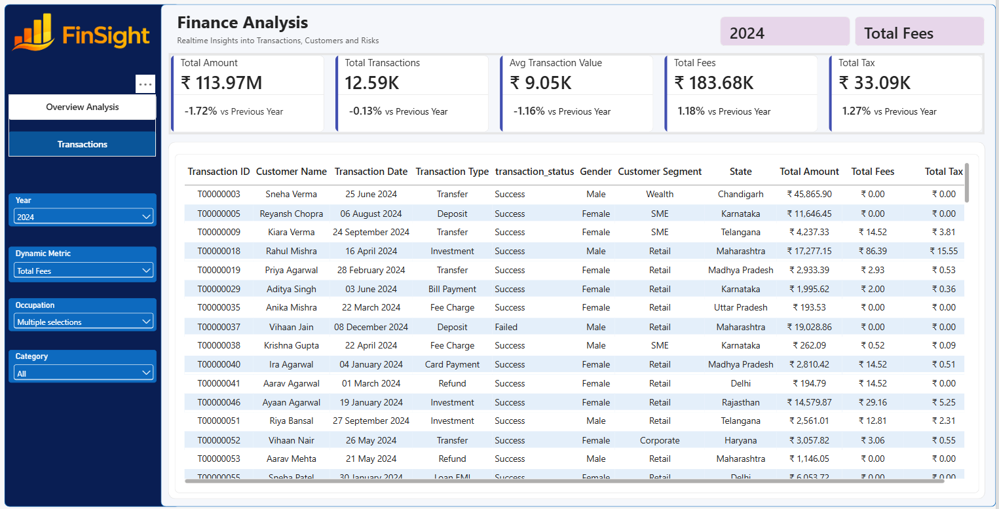

# FinSight — Finance Analytics Dashboard

An interactive finance analytics dashboard built using **Microsoft Power BI** to analyze financial transactions, customer behavior, transaction fees, taxes, and business performance across regions and customer segments.

## Project Overview

FinSight provides a centralized view of financial activity through key performance indicators, interactive visualizations, and transaction-level analysis. It helps users explore transaction trends, compare customer contributions, evaluate regional performance, and understand how different transaction types contribute to overall financial activity.

The project focuses on transforming raw financial and customer datasets into a structured analytical solution that supports business monitoring and data-driven decision-making.

## Business Objectives

- Monitor key financial indicators, including total transaction amount, transaction count, average transaction value, total fees, and total tax.
- Analyze monthly transaction trends and identify changes in financial activity.
- Examine the distribution of successful, failed, and pending transactions.
- Compare transaction contributions across customer segments and states.
- Analyze transaction activity by transaction type, including amounts, fees, taxes, and transaction counts.
- Understand customer contribution across demographic categories such as gender.
- Enable interactive exploration of financial data through report filters.

## Dashboard Features

### 1. Key Performance Indicators (KPIs)

The dashboard includes the following financial metrics:

- **Total Amount:** Total value of transactions processed.
- **Total Transactions:** Number of transactions recorded.
- **Average Transaction Value:** Average monetary value per transaction.
- **Total Fees:** Total fees associated with transactions.
- **Total Tax:** Total tax associated with transactions.

### 2. Monthly Transaction Trends

An area chart visualizes transaction amounts over time, helping users identify monthly increases, decreases, and potential patterns in financial activity.

### 3. Transaction Status Analysis

A donut chart displays transaction amounts by status, including successful, failed, and pending transactions, to help examine transaction outcomes.

### 4. Customer Segment Analysis

A horizontal bar chart compares transaction amounts across customer segments, such as Retail, Premium, SME, Corporate, and Wealth.

### 5. State-wise Financial Performance

A horizontal bar chart compares transaction amounts across states to help identify regions with higher financial activity.

### 6. Transaction Type Analysis

A detailed matrix analyzes transaction types using multiple measures:

- Transaction Amount
- Fees
- Tax
- Transaction Count

Transaction categories include bill payments, card payments, deposits, fee charges, interest credits, investments, loan EMIs, refunds, transfers, and withdrawals.

### 7. Gender-based Analysis

A donut chart compares transaction contributions across gender categories, supporting demographic analysis of financial activity.

### 8. Interactive Filters

The report includes interactive filters for:

- Year
- Dynamic Measure
- Occupation
- Category

The dynamic measure selection allows users to explore different financial metrics in the relevant visualizations.

## Data Preparation

Data preparation was performed in **Power Query** before building the finance analytics dashboard in Power BI.

### Customer Data

- Assigned appropriate data types to the source columns.
- Combined the first-name and second-name fields into a single `customer_name` column, separated by a space.

### Financial Transaction Data

- Assigned appropriate data types to the source columns.
- Removed duplicate records.
- Trimmed whitespace from the `channel` column.
- Applied the absolute value function to the `amount` column to make transaction amounts non-negative.
- Replaced missing `fee_amount` values with a fixed numeric value.
- Changed the `fee_amount` column to the Currency data type.
- Converted values in the `currency` column to uppercase for consistent formatting.

### Data Organization

The repository separates the original source datasets from the cleaned output datasets. This makes it easier to review the input data, inspect the prepared data, and understand the workflow used to create the dashboard.

## Tools and Technologies

- **Microsoft Power BI Desktop** — dashboard development and visualization.
- **Power Query** — data preparation and transformation.
- **Microsoft Excel** — source datasets and cleaned data.
- **DAX / Power BI measures** — KPI calculations and analytical measures, where used.

## Repository Structure

## Repository Structure

```text
FinSight-Finance-Analytics/
├── Finance_Dashboard.pbix
├── Business Requirements.docx
├── README.md
├── raw_data/
│   ├── README.md
│   ├── customers.xlsx
│   └── finance_transactions.xlsx
└── cleaned_data/
    ├── README.md
    └── cleaned_cust_trans_data.xlsx
```

## How to Explore the Project

1. Review "Business Requirements.docx" to understand the business problem and intended analytical requirements.
2. Explore "raw_data/" to view the original source datasets.
3. Explore "cleaned_data/" to inspect the prepared data.
4. Download "Finance_Dashboard.pbix" and open it using Microsoft Power BI Desktop.
5. Use the dashboard filters and visualizations to explore financial performance from different perspectives.

## Business Value

FinSight demonstrates how financial and customer datasets can be organized into an interactive reporting solution. By bringing key metrics and multiple analytical views into one dashboard, the project supports the investigation of transaction trends, customer segments, regional activity, transaction outcomes, fees, and taxes.

The project also demonstrates practical skills in data preparation, business-oriented analytics, KPI reporting, and interactive dashboard development.

## Project Status

This project was developed as a finance analytics portfolio project. The dashboard and documentation can be further improved by adding screenshots, documenting the exact data-cleaning steps, and describing any additional analytical measures implemented in the report.

## Dashboard Preview

### Overview Page



## Dashboard Preview

### Overview Page


### Transactions Page


